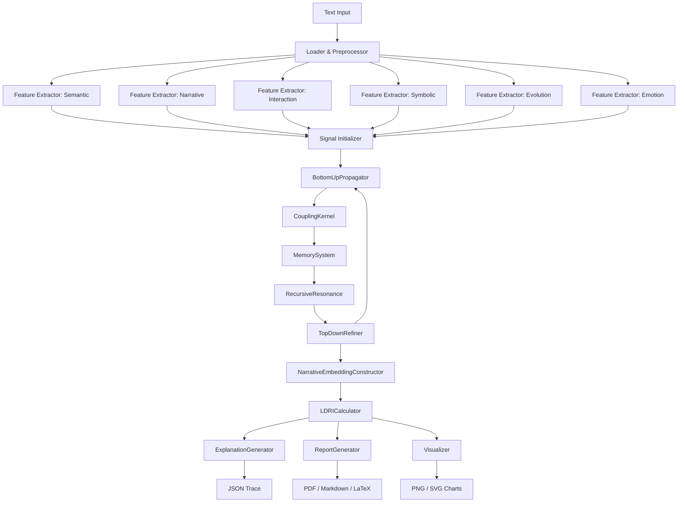

# LIT-DISC Framework Summary

**Version:** v1.1 (sigma_max = 5.0)  
**Based on:** HMP-DT v1.0 (Research Freeze), LDRI Methodology v1.0  

---

## Mathematical Formulation

### HMP-DT Core

The Hierarchical Message Passing on Discourse Trees (HMP-DT) models literary text as coupled signal systems propagating through a discourse hierarchy (sentence → paragraph → chapter → work) across six dimensions:

$$\mathcal{D} = \{S, N, I, Sy, E, Em\}$$

**Bottom-up propagation:** Signals aggregate upward: $s_{i}^{(l)} = \oplus_{j \in \text{children}(i)} s_{j}^{(l-1)}$ using a weighted coupling kernel.

**Coupling kernel:** $K(\tau_i, \tau_j) = \sum_{c \in \mathcal{C}} \omega_c \cdot K_c(\tau_i, \tau_j)$ combines similarity, proximity, confidence, completion, symmetry, and relation kernels.

**Memory:** Random Fourier Feature (RFF) key generation with cosine-similarity retrieval. Store threshold $\theta_{\text{store}} = 0.5$, retrieve threshold $\theta_{\text{retrieve}} = 0.7$, max size = 200.

**Resonance:** Recursive resonance field $R(t+1) = \lambda R(t) + \eta \cdot A(t)$ with decay $\lambda = 0.3$ and update rate $\eta = 0.2$.

**Uncertainty:** Bootstrap-based confidence estimation with $n_{\text{samples}} = 100$.

### LDRI (Literary Discourse Richness Index)

$$\text{LDRI} = \Gamma_{\text{global}} \times \big(R_{\text{signal}}^2 \cdot C_{\text{tilde}} \cdot T_{\text{tilde}} \cdot M_{\text{tilde}}\big)^{1/5}$$

Where:
- $\Gamma_{\text{global}} = \prod_{d \in \mathcal{D}} \gamma_d$ — per-dimension confidence product
- $R_{\text{signal}} = \frac{1}{|\mathcal{D}|} \sum_{d \in \mathcal{D}} a_d$ — mean RBF activation
- $a_d = 1 - \exp(-\|H_d\|^2 / 2\sigma^2)$ — Gaussian RBF activation
- $C_{\text{tilde}}$ — normalized coupling strength
- $T_{\text{tilde}}$ — temporal coherence
- $M_{\text{tilde}}$ — memory contribution

### Six components (variance decomposition)

$$\text{LDRI} = \text{Intrinsic} + \text{Interaction} + \text{Temporal} + \text{Memory} + \text{Resonance} + \text{Uncertainty}$$

---

## Pipeline Overview

```
[Text Input]
     |
[1. Load & Preprocess]  → Tokenizer, SentenceSplitter, Paragraph/Chapter detection
     |
[2. Feature Extraction] → 6 parallel extractors (semantic, narrative, interaction,
     |                      symbolic, evolution, emotion)
     v
[3. HMP-DT Core]       → SignalInitializer → BottomUpPropagator →
     |                      CouplingKernel → MemorySystem → Resonator →
     |                      TopDownRefiner (K=5 iterations)
     v
[4. Narrative Embedding] → Subspace construction from H_d vectors (d=120)
     |
[5. LDRI Calculation]   → RBF activation → Gamma confidence → Raw LDRI → Final LDRI
     |
[6. Output]            → Explanation trace → Reports → Visualizations
```

---

## Architecture Diagram (Mermaid)



---

## Parameter Table

| Parameter | Symbol | Value | Location |
|-----------|--------|-------|----------|
| RBF kernel width | $\sigma_{\max}$ | **5.0** | `config.py:LDRIParams.sigma_max` |
| Alpha (uncertainty exponent) | $\alpha$ | 2.0 | `config.py:LDRIParams.alpha` |
| Beta | $\beta$ | 1.0 | `config.py:LDRIParams.beta` |
| Gamma | $\gamma$ | 1.0 | `config.py:LDRIParams.gamma` |
| Delta | $\delta$ | 1.0 | `config.py:LDRIParams.delta` |
| Bootstrap samples | $n$ | 100 | `config.py:LDRIParams.bootstrap_samples` |
| Refinement iterations | $K$ | 5 | `config.py:HMPDTConfig.refinement_iterations` |
| Beta salience | $\beta_{\text{sal}}$ | 2.0 | `config.py:HMPDTConfig.beta_salience` |
| Beta top-down | $\beta_{\text{td}}$ | 0.3 | `config.py:HMPDTConfig.beta_topdown` |
| Convergence threshold | $\epsilon$ | $10^{-6}$ | `config.py:HMPDTConfig.epsilon_convergence` |
| Memory key dimension | $d_{\text{key}}$ | 32 | `config.py:MemoryParams.key_dim` |
| Memory sigma (RFF) | $\sigma_{\text{mem}}$ | 1.0 | `config.py:MemoryParams.sigma_kernel` |
| Memory store threshold | $\theta_{\text{store}}$ | 0.5 | `config.py:MemoryParams.theta_store` |
| Memory retrieve threshold | $\theta_{\text{ret}}$ | 0.7 | `config.py:MemoryParams.theta_retrieve` |
| Memory forget threshold | $\theta_{\text{forget}}$ | 0.01 | `config.py:MemoryParams.theta_forget` |
| Memory max size | $M_{\max}$ | 200 | `config.py:MemoryParams.max_size` |
| Resonance decay | $\lambda$ | 0.3 | `config.py:ResonanceParams.lambda_decay` |
| Resonance update rate | $\eta$ | 0.2 | `config.py:ResonanceParams.eta_resonance` |
| Embedding dimension | $d$ | 120 | `config.py:EmbeddingParams.dimension` |

---

## Component Explanations

### 1. Loader & Preprocessor
Reads text (TXT, EPUB, XML), tokenizes into sentences, detects paragraphs and chapters via regex patterns. Language-agnostic for sentence splitting (abbreviation lists, punctuation rules).

### 2. Feature Extractors (6 dimensions)
Each dimension has 7–8 feature functions producing normalized vectors in $[0,1]^k$ (or $[-1,1]^k$ for sentiment/change features):
- **Semantic:** Density, thematic concentration, lexical richness
- **Narrative:** Tension arc, structural progression
- **Interaction:** Dialogue density, speaker asymmetry, politeness
- **Symbolic:** Motif recurrence, sensory density, metaphor markers
- **Evolution:** Relationship trajectory, thematic development
- **Emotion:** Valence, arousal, emotional volatility

### 3. HMP-DT Core (K=5 iterations)
Iterative bottom-up/top-down propagation with coupling, memory, resonance, and uncertainty estimation. The refinement loop converges when signal change < $10^{-6}$.

### 4. Narrative Embedding
Constructs per-dimension embedding vectors $H_d$ from propagated signals. Each $H_d$ concatenates feature vectors across the hierarchy, projected to the common dimension $d = 120$.

### 5. LDRI Calculation
Computes RBF activation $a_d = 1 - \exp(-\|H_d\|^2 / 2\sigma^2)$ for each dimension, then aggregates via geometric mean of $R_{\text{signal}}^2$, $C_{\text{tilde}}$, $T_{\text{tilde}}$, $M_{\text{tilde}}$, scaled by global confidence $\Gamma_{\text{global}}$.

### 6. Output Generators
Explanation trace (JSON), multi-format reports (Markdown, LaTeX, HTML), and visualizations (radar charts, component breakdowns, trajectory plots).

---

## Sigma = 5.0 Rationale

The Gaussian RBF activation $a_d = 1 - \exp(-\|H_d\|^2 / 2\sigma^2)$ determines how much of each dimension's signal contributes to LDRI.

**At sigma=0.1 (v1.0):** Feature norms $\|H_d\| \approx 10-14$ gave $a_d = 1.0$ for all 150 activations (99% saturation). With $a_d$ constant, $R_{\text{signal}}$ was invariant, and $\text{raw\_ldri}$ was effectively constant (CV = 0.3%).

**At sigma=5.0 (v1.1):** Activations span 0.54–0.99 across dimensions and passages. $R_{\text{signal}}$ becomes variable (CV = 2.7%), and $\text{raw\_ldri}$ CV increases to 2.6% (8.5x improvement). Only 4% of activations remain saturated.

**Selection:** sigma=5.0 was chosen from a 10-value sweep (0.05–10.0) as the smallest value that (a) eliminates near-total saturation and (b) produces variable activations while preserving ranking structure (author Spearman ρ = 0.98 vs v1.0).

---

## v1.1 Changes from v1.0

| Aspect | v1.0 | v1.1 |
|--------|------|------|
| sigma_max | 0.1 | 5.0 |
| File changed | — | `src/config.py:59` |
| Activation saturation | 99% | 4% |
| Raw LDRI CV | 0.3% | 2.6% |
| Gamma dominance | 100.3% | 96.5% |
| LDRI CV | 44.8% | 47.9% |
| Category ranking | SNC>MLC>NWC>MNC>SSC | SNC>MLC>NWC>SSC>MNC |
| Author ranking ρ | — | 0.98 |
| Runtime | 0.86s avg (passages) | 0.21s avg (passages) |

No equations, algorithms, or other parameters were changed.
